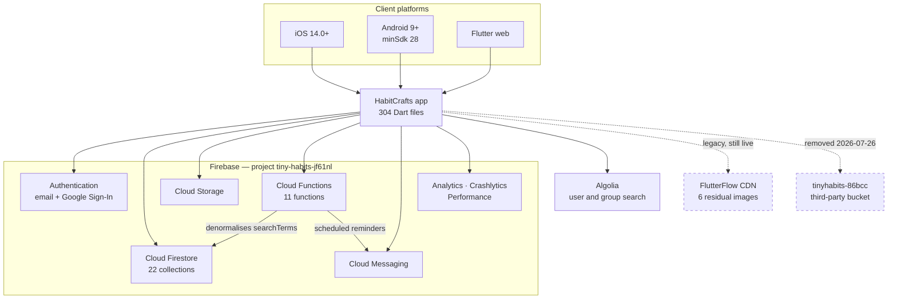

# 01 — System Context

What HabitCrafts talks to, and where the trust boundary sits.

## The Firebase dependency is total

Every stateful concern — identity, data, files, server logic, push, crash reporting — runs through
a single Firebase project, `tiny-habits-jf61nl`. There is no second backend and no abstraction
layer between the app and the Firebase SDKs. Firestore reads appear directly in widget code.

This is worth naming plainly because it sets the cost of any future migration off Firebase: it
would touch nearly every file in `lib/`. That is not an argument against Firebase. It is an
argument for not assuming an exit is cheap.

## The trust boundary is thinner than it looks

Firestore is reached **directly from the client**. There is no API tier in between. That means
Firestore security rules are not one layer of defence among several — they are the *only* thing
standing between an anonymous caller and the database.

Those rules require a real sign-in to read a user document, and an anonymous Firebase user counts
as signed out (`signedIn()` in `firebase/firestore.rules`). See issue #1.

## Residual FlutterFlow dependency

Six images are still served from FlutterFlow's own CDN, under a path containing the old project
ID. All six currently return HTTP 200, so nothing is broken, but they sit on the infrastructure
of a platform this project has otherwise left.

## A dependency that had already failed

Until 2026-07-26 the check-in slider loaded five emoji from `tinyhabits-86bcc.appspot.com` — a
Firebase project belonging to **someone else**. That project sits on the Spark plan, which
Firebase no longer serves Cloud Storage for, so all five URLs returned HTTP 402 and the slider
thumb never rendered.

The lesson generalises: FlutterFlow custom code can embed references to infrastructure nobody on
this project controls, and nothing in the build will warn you.
