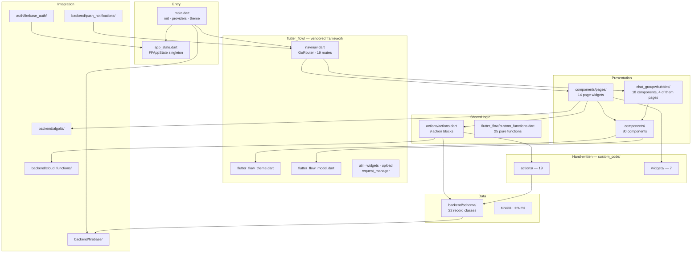

# 02 — Module Map

How `lib/` stratifies, and where new code belongs.

## The three kinds of code here

Not all of `lib/` deserves equal treatment, and conflating them is the fastest way to make a mess.

**Vendored framework — `lib/flutter_flow/`.** 23 files of FlutterFlow's runtime support, identical
across every project it exports. Theme, model lifecycle, routing, upload helpers, a stream request
manager. Treat this as a third-party dependency you happen to have the source of. Editing it is
possible but means owning a fork of code you did not write and cannot easily re-derive.

**Generated application code — `components/`, `chat_groupwbubbles/`, `backend/schema/`.** Machine
output: verbose widget trees, repetitive record classes, deep nesting. It is real code and you now
own it, but it reads like a build artefact because it was one. Rewriting it by hand is legitimate
now that FlutterFlow is no longer the source of truth — that was the point of leaving.

**Hand-written — `lib/custom_code/`.** 19 actions and 7 widgets, the escape hatch where a human
wrote Dart because the builder could not express something. **This is where defects concentrate.**
It is the only code in the project that FlutterFlow neither generated nor validated. The broken
check-in slider lived here, and carried three separate latent bugs alongside its dead URLs.

When something misbehaves, look in `custom_code/` first.

## Where new code belongs

- **New screen** → `components/pages/`, registered in `flutter_flow/nav/nav.dart`
- **Reusable UI** → `components/`
- **Logic used by more than one screen** → `actions/actions.dart`
- **Pure computation** → `flutter_flow/custom_functions.dart`
- **New Firestore collection** → `backend/schema/`, plus rules in `firebase/firestore.rules`. Use
  the `signedIn()` helper there, never a bare `request.auth != null`, so the hidden anonymous
  scoring user stays locked out (PIN-9).
- **Anything touching platform APIs** → `custom_code/actions/`

## State management

A single `FFAppState` singleton behind `ChangeNotifierProvider`, hydrated from shared preferences
at startup before `runApp`. It holds onboarding flags, EULA acceptance, the check-in slider value,
temporary document references used to pass data between screens, and cached contact lookups.

Two observations. Temporary refs (`_tempHabitRef`, `_tempReminderRef`, `_tempActivityRef`) are
global mutable state used as an inter-screen argument channel — workable, but it means screen
behaviour can depend on what ran before it. And `_marksUserId` is a hardcoded developer reference
sitting in production app state.

## The chat module is structurally distinct

`lib/chat_groupwbubbles/` is 18 components forming a self-contained feature — threads, invites,
reactions, flagging, media, overlays — with its own internal page widgets rather than living under
`components/pages/`. It is the one part of the tree organised by feature instead of by kind.

If the codebase ever moves to feature-first organisation, this is the template and the precedent.
