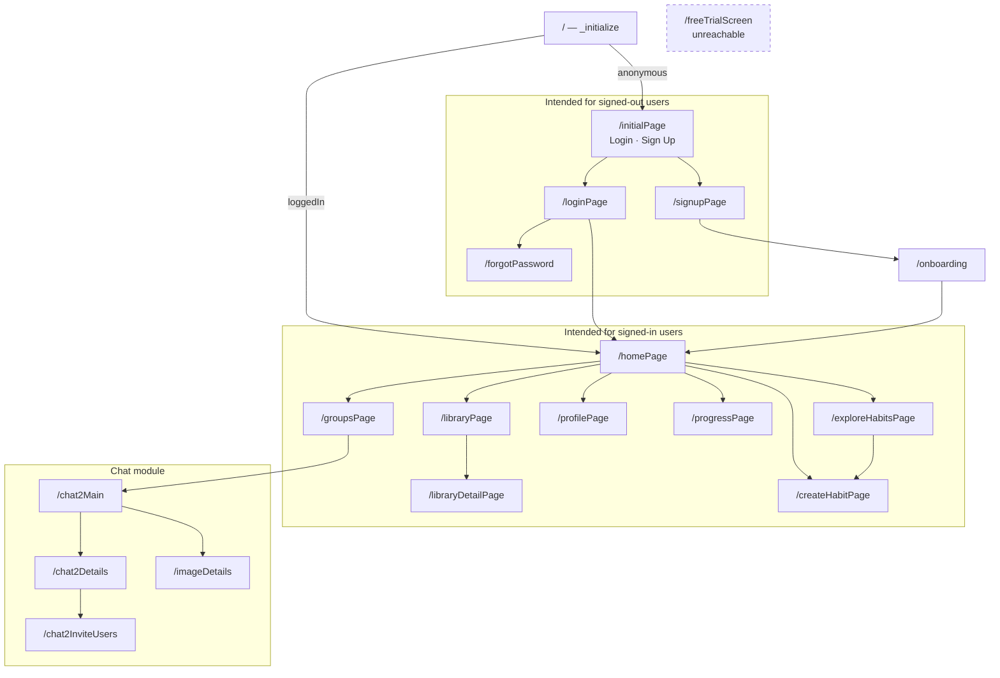

# 03 — Navigation

GoRouter, configured in [`lib/flutter_flow/nav/nav.dart`](../../lib/flutter_flow/nav/nav.dart).
19 routes: a root initializer plus 18 pages.

## No route requires authentication

The mechanism exists and is correct. `FFRoute` takes a `requireAuth` flag, and
[nav.dart:450](../../lib/flutter_flow/nav/nav.dart#L450) implements the guard properly — it
redirects to `/initialPage` and remembers where the user was headed so they land there after
signing in.

**It is never switched on.** `requireAuth: true` appears zero times in the file. Every route uses
the default, `this.requireAuth = false`.

The only real gate is the root route, which shows `HomePageWidget` or `InitialPageWidget`
depending on `appStateNotifier.loggedIn`. That covers a user who opens the app at `/` and taps
through — which is why this is not obvious in normal use.

It does not cover anyone who arrives at a path directly. On web, where routes are URLs and
`usePathUrlStrategy()` is enabled, `/profilePage` is simply a link. Deep links on mobile behave
the same way.

What an unauthenticated visitor actually sees depends on how each page handles a null user —
some will render empty, some will throw. That is incidental behaviour, not a security boundary.
The data itself is protected only by Firestore rules, which currently permit unauthenticated
reads of every user document (issue #1).

Fixing this is mechanical: add `requireAuth: true` to the 14 routes intended for signed-in users.
It is worth doing regardless of the rules work, because the two defend different things — rules
protect the data, the router protects the experience.

## The orphaned trial screen

`/freeTrialScreen` is registered and reachable by URL, but **nothing in the app navigates to it**.
The only references are its route registration and its export in `index.dart`.

It is a 675-line screen whose entire copy is "Try 7 Days for Free", and there is no billing
integration anywhere in the project. Treat it as dead code pending a decision, not as a feature.

## Structural notes

Navigation is flat. Every route sits at the top level with no nesting, so there are no shared
parent layouts or nested navigators — each page renders its own scaffold and any bottom
navigation independently.

Four of the chat module's components are pages registered here (`chat2Main`, `chat2Details`,
`chat2InviteUsers`, `imageDetails`) while living in `lib/chat_groupwbubbles/` rather than
`components/pages/`. Route registration and file location disagree; the router is authoritative.
